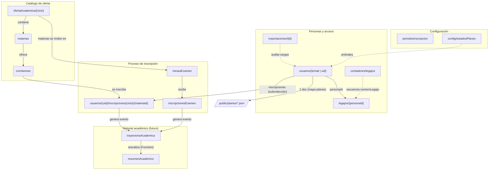

# Modelo de datos de Firestore — SIGE

> **Estado (30/10/2026):** modelo **v2 aprobado** en la etapa E0 del
> [plan de carga de usuarios](plan-carga-usuarios-202610.md). Este documento describe el
> **modelo objetivo** y marca explícitamente qué está implementado hoy y qué se implementa en
> las etapas siguientes.
>
> **Datos actuales:** Firestore solo contiene los **usuarios de prueba** cargados desde
> `data/usuarios.csv` (9 filas). No hay datos reales de estudiantes, docentes ni bedeles.
> Eso hace que la migración de E3 sea de bajo riesgo.
>
> **Reglas:** la matriz de permisos de §10 es el **objetivo**. `firestore.rules` se actualiza
> en E4; hasta entonces rigen las reglas actuales descriptas en
> [contexto.md](contexto.md#firestore-rules).

## 1. Diagrama general



## 2. Estado de implementación

| Colección / pieza | Estado real (30/10/2026) | Etapa |
|---|---|---|
| `usuarios` | Implementada con shape **v1** (ID = `email` → `uid`, `estado`, `planes` como array de nombres). | v2 en E3 |
| `legajos` | **No existe.** Se crea en E3 (migración de prueba) y E5/E6 (altas). | E3, E5, E6 |
| `importaciones` | **No existe.** Auditoría de cargas masivas. | E5 |
| `contadores` | **No existe.** Secuencia de `numeroLegajo`. | E5 |
| `ofertaAcademica` | Implementada (un documento por ciclo). | — |
| `usuarios/{uid}/inscripciones{ciclo}` | Implementada (subcolección por ciclo). | — |
| `planesDeEstudio` | **No existe**: los planes viven en `public/planes/*.json`. | — |
| `resumenAcademico`, `trayectoriaAcademica`, `periodosInscripcion`, `inscripcionesExamen`, `mesasExamen` | **No existen**: son diseño futuro. | Fuera de alcance |
| `firestore.rules` | Implementa el modelo v1. Bedel no puede crear usuarios; no existen reglas de `legajos`/`importaciones`. | E4 |

> El modelo v2 **no requiere migrar datos históricos reales**: solo los 9 usuarios de prueba.
> La compatibilidad de lectura durante la transición está prevista en E3.

## 3. `usuarios/{docId}`

`docId` es el **email** (lowercase) mientras el usuario está en pre-registro y pasa a ser el
**uid** de Firebase Auth cuando completa el registro. El campo `personaId` es el vínculo
estable con el legajo y **no cambia** con esa migración.

```js
{
  // Identidad
  personaId: "3f2a...uuid",        // UUID estable; nunca cambia con email/uid
  dni: "37348389",                 // string normalizado (sin puntos ni espacios)
  nombre: "María José",
  apellido: "ORTEGA",
  email: "majo@ejemplo.com",       // lowercase

  // Acceso
  roles: ["estudiante"],           // lowercase, sin duplicados
  estadoRegistro: "pendiente_registro" | "registrado",
  uid: "<uid>",                    // solo post-registro
  estadoUsuario: "activo" | "inactivo",
  estadoUsuarioActualizadoEn: Timestamp,
  motivoEstado: "",                // opcional, para inactivo

  // Académico
  planes: {
    "662": {
      id: "662",
      nombre: "662 Profesorado de Música",  // snapshot para mostrar sin leer planes.json
      estado: "ingresante",                 // ingresante | activo | por_vencer | vencido | graduado | condicional
      fechaInscripcion: Timestamp,          // obligatoria
      vigente: true,                        // false cuando el plan se cierra/cambia
      origen: "carga_masiva" | "alta_individual" | "pase" | "script",
      // Campos previstos para el cálculo (no se escriben en este plan):
      ultimaAcreditacion: Timestamp | null,
      estadoCalculadoEn: Timestamp | null
    }
  },

  // Legajo: solo el número; el resto vive en legajos/{personaId}
  numeroLegajo: "2026-0001" | null,

  creadoEl: Timestamp,
  actualizadoEn: Timestamp
}
```

### 3.1 Campos y reglas de normalización

- `personaId`: UUID generado en el cliente (`crypto.randomUUID()`) al crear el pre-registro.
  Es la clave del legajo.
- `dni`: string, sin puntos ni espacios. Se valida contra los DNI existentes antes del alta.
- `email`: lowercase y sin espacios. En pre-registro debe coincidir con el ID del documento.
- `roles`: array no vacío, lowercase, sin duplicados. Valores válidos: `estudiante`,
  `docente`, `bedel`, `coordinacion`, `admin`.
- `estadoRegistro`: reemplaza al campo v1 `estado`, que solo significaba “pendiente de
  registro”. No confundir con `estadoUsuario` ni con el estado de cada plan.
- `estadoUsuario`: decisión **administrativa** (activo/inactivo). No se deriva de los planes y
  no existe `inactivo-graduado`: la graduación es por plan.
- `planes`: mapa por **código de plan**, no array. Permite actualizar un plan de forma atómica
  (`updateDoc({ 'planes.662.estado': ... })`) y sobrevive a la migración `email → uid`.
- `numeroLegajo`: número administrativo generado en la carga masiva o por el bedel. La fuente
  única es `legajos.numeroLegajo`; en `usuarios` se denormaliza para listados.
- No existe un campo `carrera` separado: **carrera = plan**. Un usuario puede tener varios
  planes.

### 3.2 Compatibilidad con el shape v1

| v1 (implementado) | v2 (objetivo) |
|---|---|
| `estado: "pendiente_registro"` | `estadoRegistro: "pendiente_registro"` |
| `planes: ["662 Profesorado de Música"]` (array de nombres o de códigos) | `planes: { "662": { id, nombre, estado, ... } }` |
| `plan` (singular, leído por algunas vistas) | `planes` (mapa; las vistas se unifican en E3) |
| `carrera`, `legajo` (leídos por `PerfilCard`, nunca escritos) | `planes` + `legajos.numeroLegajo` |
| Sin `personaId` | `personaId` obligatorio |
| Sin `estadoUsuario` | `estadoUsuario: "activo"` por defecto |
| Sin `numeroLegajo` | `numeroLegajo` generado o `null` |

`useUsuarios.obtenerUsuario()` normaliza el shape viejo durante la transición (E3). El script
`scripts/migrar-usuarios-v2.js` hace la conversión definitiva.

### 3.3 Por qué un mapa y no una subcolección

| Criterio | Mapa por código (elegido) | Subcolección |
|---|---|---|
| Lectura del usuario | 1 documento | 1 documento + 1 query |
| Actualización de un plan | atómica por campo | atómica por documento hijo |
| Migración `email → uid` | copia el campo tal cual | hay que copiar la subcolección |
| Consultas transversales (“todos los vencidos”) | requiere campo derivado `estadosPlanes[]` | `collectionGroup` |

Se elige el mapa porque mantiene la migración actual sin cambios. Si en el futuro las consultas
transversales lo justifican, se agrega `estadosPlanes[]` mantenido por el proceso de cálculo.

## 4. Estados

Hay tres conceptos separados:

1. **Registro** (`estadoRegistro`): `pendiente_registro` | `registrado`.
2. **Estado del usuario** (`estadoUsuario`): `activo` | `inactivo`.
3. **Estado por plan** (`planes[codigo].estado`): seis valores.

### 4.1 Estado por plan

| Estado | Significado |
|---|---|
| `ingresante` | Cursando el pregrado del plan. Se mantiene hasta completar **todas** las materias de pregrado (no dura un año fijo). Solo en planes con pregrado. |
| `activo` | Cursando con regularidad, ya fuera del pregrado, o inscripto en un plan sin pregrado. |
| `por_vencer` | Aviso previo al vencimiento (umbral configurable). **Calculado, no se carga a mano.** |
| `vencido` | Más de 4 años desde la última materia acreditada. **Calculado, no se carga a mano.** |
| `graduado` | Egresó del plan. |
| `condicional` | Viene de otra institución; cursa algunos espacios hasta que se definan las equivalencias. |

`ingresante` queda exento de vencimiento. En planes sin pregrado el estado inicial es siempre
`activo`.

### 4.2 Estado inicial al dar de alta

| Flujo | Estado inicial |
|---|---|
| Carga masiva de ingresantes | `ingresante` si el plan tiene pregrado; `activo` si no. Se calcula, no se elige. |
| Alta individual (estudiante) | El operador elige `ingresante` (solo planes con pregrado), `activo` o `condicional`. Obligatorio y coherente con el plan. |

### 4.3 Máquina de estados (solo lo decidido)

```
carga masiva:   plan con pregrado → ingresante
                plan sin pregrado  → activo

alta individual: operador elige ingresante | activo | condicional
                 (ingresante solo si el plan tiene pregrado)

condicional --(equivalencias confirmadas)--> activo
ingresante  --(todas las materias 00 acreditadas)--> activo   [calculado, fuera de alcance]
activo      --(> 4 años sin acreditar)--> vencido             [calculado, fuera de alcance]
activo      --(umbral configurable)--> por_vencer             [calculado, fuera de alcance]
cualquiera  --(egreso)--> graduado                            [quién/cuándo: abierto]
```

- `por_vencer` y `vencido` **no se cargan a mano**: se calculan a partir de
  `ultimaAcreditacion` (ver §4.4).
- `vigente: false` cierra una entrada de plan sin necesidad de un séptimo estado.
- Si un `condicional` termina cambiando de plan, se cierra la entrada anterior (`vigente:
  false`) y se agrega una nueva con su propia `fechaInscripcion`; no se pisa el historial.

### 4.4 Cálculo futuro (fuera de alcance)

- `ingresante → activo`: todas las materias de año `0` del plan acreditadas en
  `trayectoriaAcademica`. Recomendación: trigger sobre `trayectoriaAcademica` + reconciliación
  periódica.
- `por_vencer` / `vencido`: `vencido` si pasaron más de 4 años desde `ultimaAcreditacion`;
  `por_vencer` según `umbralPorVencerMeses`. Recomendación: proceso programado que actualiza
  `planes[codigo].estado`, `ultimaAcreditacion` y un campo derivado `estadosPlanes[]`.
- Parámetros en `config/estadosPlanes`: `umbralPorVencerMeses` (sin definir),
  `aniosVencimiento = 4`, `aniosFiltroPrevios = 3` (solo si se usa pre-filtro).
- **No** se usa un pre-filtro basado solo en `fechaInscripcion`: las equivalencias y los
  reingresos pueden tener acreditaciones anteriores. La fuente es `ultimaAcreditacion` por
  plan.

### 4.5 `estadoUsuario` guardado vs derivado

Se **guarda** como decisión administrativa (suspensión, desvinculación). La UI muestra el
estado académico calculado a partir de los planes `vigentes` y **advierte** si
`estadoUsuario = inactivo` convive con planes en estados activos; no se auto-escribe uno a
partir del otro.

## 5. `legajos/{personaId}` — Legajo digital

Colección nueva. **Un legajo por persona**, no por plan. El ID es `personaId`.

```js
{
  personaId: "3f2a...uuid",
  numeroLegajo: "2026-0001",
  usuarioDocId: "email-o-uid",     // referencia informativa, puede cambiar
  dni: "...", nombre: "...", apellido: "...",   // snapshot
  fechaNacimiento: Timestamp | null,
  domicilios: [
    { tipo: "real" | "legal", calle, numero, piso, depto, localidad, provincia, cp }
  ],
  telefonos: [
    { tipo: "fijo" | "celular", numero, whatsapp: true }
  ],
  datosAdministrativos: {},        // extensible
  documentacion: [                 // previsto, no implementado
    { tipo: "dni_frente" | "dni_dorso" | "partida" | "foto", estado, url, validadoEn, validadoPor }
  ],
  creadoEl: Timestamp,
  actualizadoEn: Timestamp,
  actualizadoPor: "<uid>"
}
```

- Solo datos **administrativos**; no duplica los datos de acceso de `usuarios`.
- Se crea en el mismo `writeBatch` que el pre-registro (carga masiva, alta individual y
  migración de los usuarios de prueba).
- Puede crearse **vacío** (sin datos administrativos) para que todo usuario tenga legajo.
- El número se llama siempre `numeroLegajo`; la fuente única es este documento.
- Permisos objetivo: bedel, coordinación y admin leen y escriben; el estudiante no (queda
  previsto para una futura solicitud de actualización, fuera de alcance).
- El vínculo **no** es el email ni el uid: es `usuarios.personaId`. Un cambio de email no
  mueve el legajo.

## 6. `importaciones/{id}` y `contadores/{id}`

### 6.1 Auditoría de cargas

```js
// importaciones/{id}
{
  tipo: "usuarios",
  origen: "carga_masiva" | "script",
  usuario: "<uid o email>",
  archivoNombre: "usuarios.csv",
  archivoHash: "sha256...",
  totalFilas: 800,
  importados: 800,
  errores: [],
  creadoEn: Timestamp
}
```

Se escribe al finalizar una carga masiva. No guarda el CSV completo ni datos personales
innecesarios: solo el hash y los totales. Permisos objetivo: escritura para coordinación y
admin.

### 6.2 Contador de legajos

```js
// contadores/legajos
{ valor: 42, actualizadoEn: Timestamp }
```

Secuencia transaccional para generar `numeroLegajo`. El formato previsto es `AAAA-NNNN`, pero
sigue abierto en la pregunta 8 del plan (alcance de la unicidad y formato definitivo). El
contador es la forma de evitar números repetidos cuando hay cargas concurrentes.

## 7. Colecciones implementadas

### `ofertaAcademica/{ciclo}`

- Documento único por ciclo lectivo (ej. `2026-1`).
- Campos: `nombreCiclo`, `actualizadoEn` y
  `etapas: [{ nombre, descripcion, desde, hasta, materias: [{ id, nombre, tipo, comisiones: [{ id, cupo, horario, aula, docente }] }] }]`.
- La carga in-app (rol `coordinacion`) reemplaza el documento completo.

### `usuarios/{uid}/inscripciones{ciclo}/{materiaId}`

- Subcolección dinámica: `inscripciones20261`, `inscripciones20262`, etc.
- Campos: `materiaId`, `comisionId`, `estado` (`pendiente` | `confirmada`), `fechaInscripcion`,
  `ciclo`.
- Las reglas usan un wildcard de segmento completo + `matches('^inscripciones[0-9]+$')`; las
  reglas no soportan comodines parciales.

## 8. Diseño futuro (no implementado)

Estas colecciones están documentadas como diseño, pero **no existen** en Firestore:

- **`periodosInscripcion/{periodoId}`**: ventanas de inscripción (`nombre`, `fechaApertura`,
  `fechaCierre`, `activo`).
- **`mesasExamen/{mesaId}`**: mesas de examen final (`materiaId`, `fechaExamen`, `tipo`,
  `periodoInscripcion`).
- **`inscripcionesExamen/{inscripcionId}`**: inscripción a mesa (`estudianteId`, `mesaId`,
  `materiaId`, `estado`).
- **`trayectoriaAcademica/{intentoId}`**: historial de intentos (`estudianteId`, `materiaId`,
  `tipoIntento`, `referenciaId`, `resultado`, `fecha`). Será la fuente del cálculo de estados.
- **`usuarios/{uid}/resumenAcademico/{materiaId}`**: resumen desnormalizado mantenido por una
  Cloud Function.

`planesDeEstudio` **no** se implementa: la fuente de verdad de los planes son los archivos JSON
de `public/planes/`.

## 9. Planes: JSON y detección de pregrado

- `public/planes/planes.json`: catálogo de códigos y nombres. Es la **única fuente** de nombres;
  no se hardcodea en scripts ni en la app.
- `public/planes/{codigo}.json`: materias, años y correlatividades. Solo se puede dar de alta
  un plan cuyo JSON exista, se pueda normalizar y esté revisado.
- **Pregrado:** toda materia con año `0` es de pregrado. En los JSON actuales el año se escribe
  `0` (`plan-0.N`), no `AA=00`. Un plan sin materias de año `0` es “sin pregrado” y su estado
  inicial es `activo`.

### 9.1 Códigos de plan

- El **código canónico** es el que figura en `planes.json`, tratado siempre como **string**:
  `662`, `708`, `662G`, `662A`, `662Ñ`, etc.
- No se trunca ni se deriva el código. En particular, `62G` **no** es un código canónico: es
  un alias legacy de `662G` que puede aparecer en JSON viejos. En E2, `resolverCodigoPlan` lo
  acepta al leer y devuelve `662G`.
- En CSV v2 y en el mapa `planes` de Firestore se guarda el **código**, no el nombre. El nombre
  se resuelve desde `planes.json`; en v2 se puede guardar como snapshot
  (`planes["662"].nombre`) para mostrarlo sin leer el catálogo.
- Los arrays v1 (`planes: ["662 Profesorado de Música"]`) pueden traer nombres completos o
  códigos. La migración de E3 resuelve ambos: si el string contiene un espacio, el código es el
  primer token; si no, se usa tal cual. Nunca se escribe un array de nombres en v2.
- Los planes de orientación (`662A`…`662X`) comparten entre sí un **tronco común** y solo
  cambian la materia de instrumento fundamental. **No son idénticos al `662` sin orientación**,
  aunque tengan mucho en común. Para no mantener 24 JSON casi idénticos, el cargador puede
  componer `tronco común de orientaciones + instrumento`; la identidad del plan sigue siendo el
  código oficial (`662G`, `662A`, …).
- Google Sheets: el apóstrofo o el formato “texto” es una solución de la planilla, no del
  modelo. El CSV debe exportar el código entre comillas (`"662G"`) y el parser debe tratarlo
  como string.

### Disponibilidad actual (30/10/2026)

| Archivo | Plan interno | Materias | ¿Pregrado? | Estado |
|---|---|---|---|---|
| `662.json` | `662` | 91 | **Sí (11)** | Disponible |
| `708.json` | `708` | 29 | **No** | Disponible |
| `662G.json` | `62G` ⚠️ | 58 | **No** | **No disponible** hasta revisar/normalizar |
| Otros 34 planes de `planes.json` | — | — | — | **Bloqueados**: no tienen JSON |

`662G` es una excepción: su `Plan` interno es `62G`, usa un array legacy, códigos sin prefijo
de plan, no tiene año 0 (pregrado), tiene 4 códigos duplicados (`62G.1.1` a `62G.4.1`) y sus
equivalencias/correlativas con `662` todavía no están revisadas. Se considera no disponible y
bloquea cualquier carga que lo referencie.

## 10. Permisos (objetivo E4)

> **Importante:** esta matriz es el objetivo. `firestore.rules` todavía implementa el modelo
> v1 (ver [contexto.md](contexto.md#firestore-rules)). Bedel **no** puede crear usuarios hasta
> E4 y `legajos`/`importaciones` todavía no tienen reglas.

| Acción | Admin | Coordinación | Bedel | Estudiante |
|---|---|---|---|---|
| Leer `usuarios` | Todos | Todos | Todos | Solo el propio |
| Crear `usuarios` | Cualquier rol | `estudiante`, `docente`, `bedel` | Solo `estudiante` (pre-registro) | — |
| Editar `roles` | ✅ | ❌ | ❌ | ❌ |
| Editar datos no-roles de un estudiante | ✅ | ✅ | ✅ | Solo el propio, sin `roles` |
| Crear/actualizar `legajos` | ✅ | ✅ | ✅ | ❌ (futuro: solicitud) |
| Leer `legajos` | ✅ | ✅ | ✅ | ❌ (futuro: el propio) |
| Escribir `ofertaAcademica` | ✅ | ✅ | ❌ | ❌ |
| Escribir `importaciones` | ✅ | ✅ | ❌ | ❌ |

Validaciones mínimas en `create` de `usuarios`:

- `estadoRegistro == 'pendiente_registro'` y `uid` ausente.
- `personaId` presente con formato UUID.
- `email` igual al ID del documento (cuando el ID es email).
- `roles` no vacío; coordinación no puede incluir `admin` ni `coordinacion`.
- Bedel: `roles == ['estudiante']`.
- Si `roles` incluye `estudiante`, `planes` es un mapa no vacío.

Las reglas no pueden iterar mapas: la validación profunda (coherencia estado/plan, fechas,
planes con JSON) es del cliente + tests. Las reglas son la última barrera, no la única.

## 11. Migración y datos actuales

Firestore solo tiene los **9 usuarios de prueba** de `data/usuarios.csv`. No hay datos reales.

1. Backup / impresión de los documentos actuales.
2. `scripts/migrar-usuarios-v2.js` en **dry-run** (E3): agrega `personaId`, convierte `planes`,
   renombra `estado → estadoRegistro`, agrega `estadoUsuario: "activo"` y crea `legajos`
   vacíos.
3. Revisar el diff, aplicar y verificar login + visualización de planes.
4. Recién después habilitar la carga masiva v2 y el alta individual.

### Cambio de email (futuro, no planificado)

- **Post-registro:** el ID es `uid` y el email es solo un campo. Cambiarlo no mueve el
  documento ni el legajo; hay que actualizar Auth y Firestore en un batch.
- **Pre-registro:** el ID es el email. Cambiarlo exige crear el documento nuevo y borrar el
  viejo; `personaId` se conserva y el legajo no se toca.
- Por eso el vínculo del legajo es `personaId`, no el email.

## 12. Documentación relacionada

- [contexto.md](contexto.md) — estado real de la implementación, composables y reglas.
- [importar-usuarios.md](importar-usuarios.md) — CSV v2 y reglas de aborto.
- [plan-carga-usuarios-202610.md](plan-carga-usuarios-202610.md) — plan por etapas.
- [importar-oferta.md](importar-oferta.md) — carga de la oferta académica.
