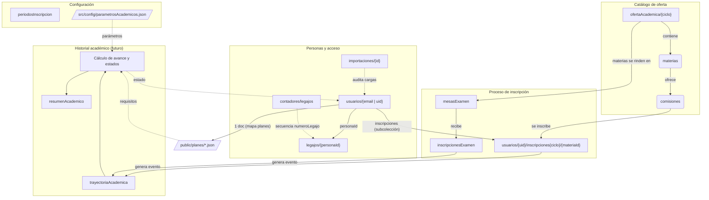

# Modelo de datos de Firestore — SIGE

> **Estado (30/10/2026):** modelo **v2 aprobado** en la etapa E0 del
> [plan de carga de usuarios](planes-implementacion/20261030-plan-carga-usuarios.md). Este documento describe el
> **modelo objetivo** y marca explícitamente qué está implementado hoy y qué se implementa en
> las etapas siguientes.
>
> **Datos actuales:** Firestore solo contiene los **usuarios de prueba** cargados desde
> `data/usuarios.csv` (9 filas). No hay datos reales de estudiantes, docentes ni bedeles.
> Eso hace que la migración de E3 sea de bajo riesgo.
>
> **Reglas:** la matriz de permisos de §10 es el **objetivo**. `firestore.rules` se actualiza
> en E4; hasta entonces rigen las reglas actuales descriptas en
> [contexto.md](contexto.md#firestore-rules).
>
> **Editor de planes (02/11/2026, cerrado 03/11/2026):** implementadas las utilidades
> `src/utils/condiciones.js` (§9.7) y `src/utils/validacionPlanes.js`, el catálogo/gating de
> `src/utils/planes.js` (§9.3), `useCatalogoPlanes.js` (§6.2), `disponible` en
> `public/planes/planes.json` (§9.6), `jsonTexto` en `planesPendientes` (§9.5) y el gate real
> en el alta de usuarios (`validarDatosUsuario`, `validarCSVUsuarios`, `useImportarUsuarios`).
>
> **Extensión v3 (11/11/2026):** se agregan `requisitos` al JSON del plan, el cálculo de avance
> y “año completo”, el historial por eventos (`cursada`, `final`, `equivalencia`), la
> condicionalidad de cursada y los parámetros académicos centralizados (§9.8–§9.10, §8). El
> **modelo v2 sigue aprobado**; esta extensión es aditiva. **Implementado:** parámetros,
> requisitos, avance, año completo, elegibilidad y espacios disponibles (`requisitos.js` más
> tests). **Pendiente:** historial, condicionalidad, estados calculados y editor.
> Documento de trabajo: [propuesta-modelo-datos-requisitos.md](planes-implementacion/propuesta-modelo-datos-requisitos.md).

## 1. Diagrama general



## 2. Estado de implementación

| Colección / pieza | Estado real (30/10/2026) | Etapa |
|---|---|---|
| `usuarios` | Implementada con shape **v1** (ID = `email` → `uid`, `estado`, `planes` como array de nombres). | v2 en E3 |
| `legajos` | **No existe.** Se crea en E3 (migración de prueba) y E5/E6 (altas). | E3, E5, E6 |
| `importaciones` | **No existe.** Auditoría de cargas masivas. | E5 |
| `contadores` | **No existe.** Secuencia de `numeroLegajo`. | E5 |
| `ofertaAcademica` | Implementada (un documento por ciclo). | — |
| `usuarios/{uid}/inscripciones{ciclo}` | Implementada (subcolección por ciclo). | — |
| `planesDeEstudio` | **No existe**: la vidriera de runtime sigue siendo `public/planes/*.json`; `planesPublicados` está inactivo y documentado sin botón ni seed. | — |
| `planesPendientes` | Implementada con `jsonTexto` (máx. 1 MB); lectura tolerante de `csvTexto` legacy. Reglas exigiendo `jsonTexto` (ver §7, §9.5). Estado `estadoRevision` con valores `en_edicion` | Editor de planes. planesPublicados documentado como inactivo. |
| `src/utils/condiciones.js` | **Implementada (02/11/2026):** conversión, recorrido y validación del árbol AND/OR/año (ver §9.7). | Editor de planes |
| `src/utils/validacionPlanes.js` | **Implementada (03/11/2026):** año reconocible, nombre, correlativas, auto-referencia y advertencias de equivalencia. | Editor de planes |
| `src/utils/planes.js` | **Implementada (02/11/2026):** `setCatalogoPlanes`, `planesDisponibles`, `validarPlanDetalle`; `resolverCodigoPlan` ya no gatea (ver §9.3). | Editor de planes |
| `src/composables/academico/useCatalogoPlanes.js` | **Implementado (02/11/2026):** carga `planes.json` con `fetch` (idempotente, deduplicado), lo inyecta en `utils/planes.js` y expone `planesDisponibles`. Se calienta desde `main.js`. | Editor de planes |
| `public/planes/planes.json` | **Con `disponible` (02/11/2026):** `662` y `708` → `true`; el resto → `false`. | Editor de planes |
| `requisitos` en el JSON del plan | **Formato definido, sin datos:** el soporte existe en `requisitos.js`; ningún plan publicado los declara todavía. | P0 |
| `src/utils/requisitos.js` | **Implementada (11/11/2026):** avance, año completo, elegibilidad, espacios disponibles, validación y parámetros. | P0/P1 |
| `src/config/parametrosAcademicos.json` | **Creado (11/11/2026):** `version: "2026.1"`, vigencias y overrides por plan (§9.10). | P0 |
| `condicionCursada` en la inscripción | **No implementado:** previsión (§7). | Futuro |
| `ciclos/{anio}` | **No existe:** calendario académico para congelar `fechaLimite`. | Futuro |
| `trayectoriaAcademica` | **No existe:** historial por eventos (§8). | Fuera de alcance |
| `resumenAcademico`, `periodosInscripcion`, `inscripcionesExamen`, `mesasExamen` | **No existen:** son diseño futuro. | Fuera de alcance |
| `firestore.rules` | Implementa el modelo v1. Bedel no puede crear usuarios; no existen reglas de `legajos`/`importaciones`. | E4 |
| `planesPublicados/{codigo}` | **Colección implementada, sin uso y sin datos**: sin botón Publicar ni seed. Exportación directa desde `planesPendientes` cuando el usuario lo requiere. No consumida por la app en runtime. | Taller editorial (decisión opción c) |

> El modelo v2 **no requiere migrar datos históricos reales**: solo los 9 usuarios de prueba.
> La compatibilidad de lectura durante la transición está prevista en E3.

## 3. `usuarios/{docId}`

`docId` es el **email** (lowercase) mientras el usuario está en pre-registro y pasa a ser el
**uid** de Firebase Auth cuando completa el registro. El campo `personaId` es el vínculo
estable con el legajo y **no cambia** con esa migración.

```js
{
  // Identidad
  personaId: "3f2a...uuid",        // UUID estable; nunca cambia con email/uid
  dni: "37348389",                 // string normalizado (sin puntos ni espacios)
  nombre: "María José",
  apellido: "ORTEGA",
  email: "majo@ejemplo.com",       // lowercase

  // Acceso
  roles: ["estudiante"],           // lowercase, sin duplicados
  estadoRegistro: "pendiente_registro" | "registrado",
  uid: "<uid>",                    // solo post-registro
  estadoUsuario: "activo" | "inactivo",
  estadoUsuarioActualizadoEn: Timestamp,
  motivoEstado: "",                // opcional, para inactivo

  // Académico
  planes: {
    "662": {
      id: "662",
      nombre: "662 Profesorado de Música",  // snapshot para mostrar sin leer planes.json
      estado: "ingresante",                 // ingresante | activo | por_vencer | vencido | graduado | condicional
      fechaInscripcion: Timestamp,          // obligatoria
      vigente: true,                        // false cuando el plan se cierra/cambia
      origen: "carga_masiva" | "alta_individual" | "pase" | "script",
      // Campos previstos para el cálculo (no se escriben en este plan):
      ultimaAcreditacion: Timestamp | null,
      estadoCalculadoEn: Timestamp | null
    }
  },

  // Legajo: solo el número; el resto vive en legajos/{personaId}
  numeroLegajo: "2026-0001" | null,

  creadoEl: Timestamp,
  actualizadoEn: Timestamp
}
```

### 3.1 Campos y reglas de normalización

- `personaId`: UUID generado en el cliente (`crypto.randomUUID()`) al crear el pre-registro.
  Es la clave del legajo.
- `dni`: string, sin puntos ni espacios. Se valida contra los DNI existentes antes del alta.
- `email`: lowercase y sin espacios. En pre-registro debe coincidir con el ID del documento.
- `roles`: array no vacío, lowercase, sin duplicados. Valores válidos: `estudiante`,
  `docente`, `bedel`, `coordinacion`, `admin`.
- `estadoRegistro`: reemplaza al campo v1 `estado`, que solo significaba “pendiente de
  registro”. No confundir con `estadoUsuario` ni con el estado de cada plan.
- `estadoUsuario`: decisión **administrativa** (activo/inactivo). No se deriva de los planes y
  no existe `inactivo-graduado`: la graduación es por plan.
- `planes`: mapa por **código de plan**, no array. Permite actualizar un plan de forma atómica
  (`updateDoc({ 'planes.662.estado': ... })`) y sobrevive a la migración `email → uid`.
- `numeroLegajo`: número administrativo generado en la carga masiva o por el bedel. La fuente
  única es `legajos.numeroLegajo`; en `usuarios` se denormaliza para listados.
- No existe un campo `carrera` separado: **carrera = plan**. Un usuario puede tener varios
  planes.

### 3.2 Compatibilidad con el shape v1

| v1 (implementado) | v2 (objetivo) |
|---|---|
| `estado: "pendiente_registro"` | `estadoRegistro: "pendiente_registro"` |
| `planes: ["662 Profesorado de Música"]` (array de nombres o de códigos) | `planes: { "662": { id, nombre, estado, ... } }` |
| `plan` (singular, leído por algunas vistas) | `planes` (mapa; las vistas se unifican en E3) |
| `carrera`, `legajo` (leídos por `PerfilCard`, nunca escritos) | `planes` + `legajos.numeroLegajo` |
| Sin `personaId` | `personaId` obligatorio |
| Sin `estadoUsuario` | `estadoUsuario: "activo"` por defecto |
| Sin `numeroLegajo` | `numeroLegajo` generado o `null` |

`useUsuarios.obtenerUsuario()` normaliza el shape viejo durante la transición (E3). El script
`scripts/migrar-usuarios-v2.js` hace la conversión definitiva.

### 3.3 Por qué un mapa y no una subcolección

| Criterio | Mapa por código (elegido) | Subcolección |
|---|---|---|
| Lectura del usuario | 1 documento | 1 documento + 1 query |
| Actualización de un plan | atómica por campo | atómica por documento hijo |
| Migración `email → uid` | copia el campo tal cual | hay que copiar la subcolección |
| Consultas transversales (“todos los vencidos”) | requiere campo derivado `estadosPlanes[]` | `collectionGroup` |

Se elige el mapa porque mantiene la migración actual sin cambios. Si en el futuro las consultas
transversales lo justifican, se agrega `estadosPlanes[]` mantenido por el proceso de cálculo.

## 4. Estados

Hay tres conceptos separados:

1. **Registro** (`estadoRegistro`): `pendiente_registro` | `registrado`.
2. **Estado del usuario** (`estadoUsuario`): `activo` | `inactivo`.
3. **Estado por plan** (`planes[codigo].estado`): seis valores.

### 4.1 Estado por plan

| Estado | Significado |
|---|---|
| `ingresante` | Cursando el pregrado del plan. Se mantiene hasta cumplir **todos los requisitos del año 0** (obligatorios + mínimos de optativos), no hasta completar la lista entera de materias ni un año fijo. Solo en planes con pregrado. |
| `activo` | Cursando con regularidad, ya fuera del pregrado, o inscripto en un plan sin pregrado. |
| `por_vencer` | Aviso previo al vencimiento según `plan.umbralPorVencerMeses` (§9.10). **Calculado, no se carga a mano.** |
| `vencido` | Más de `plan.aniosVencimiento` años (hoy 4) desde `ultimaAcreditacion`. **Calculado, no se carga a mano.** |
| `graduado` | Egresó del plan. |
| `condicional` | Viene de otra institución; cursa algunos espacios hasta que se definan las equivalencias. |

`ingresante` queda exento de vencimiento. En planes sin pregrado el estado inicial es siempre
`activo`.

### 4.2 Estado inicial al dar de alta

| Flujo | Estado inicial |
|---|---|
| Carga masiva de ingresantes | `ingresante` si el plan tiene pregrado; `activo` si no. Se calcula, no se elige. |
| Alta individual (estudiante) | El operador elige `ingresante` (solo planes con pregrado), `activo` o `condicional`. Obligatorio y coherente con el plan. |

### 4.3 Máquina de estados (solo lo decidido)

```
carga masiva:   plan con pregrado → ingresante
                plan sin pregrado  → activo

alta individual: operador elige ingresante | activo | condicional
                 (ingresante solo si el plan tiene pregrado)

condicional --(equivalencias confirmadas)--> activo
ingresante  --(todos los requisitos del año 0 cumplidos)--> activo   [calculado, fuera de alcance]
activo      --(> plan.aniosVencimiento años sin acreditar)--> vencido [calculado, fuera de alcance]
activo      --(plan.umbralPorVencerMeses)--> por_vencer              [calculado, fuera de alcance]
cualquiera  --(egreso)--> graduado                            [quién/cuándo: abierto]
```

- `por_vencer` y `vencido` **no se cargan a mano**: se calculan a partir de
  `ultimaAcreditacion` (ver §4.4).
- `vigente: false` cierra una entrada de plan sin necesidad de un séptimo estado.
- Si un `condicional` termina cambiando de plan, se cierra la entrada anterior (`vigente:
  false`) y se agrega una nueva con su propia `fechaInscripcion`; no se pisa el historial.

### 4.4 Cálculo futuro (fuera de alcance)

- `ingresante → activo`: todos los requisitos del año `0` del plan cumplidos en
  `trayectoriaAcademica` (obligatorios + mínimos de optativos), no “todas las materias”.
  Recomendación: trigger sobre `trayectoriaAcademica` + reconciliación periódica.
- `por_vencer` / `vencido`: `vencido` si pasaron más de `plan.aniosVencimiento` años (hoy 4)
  desde `ultimaAcreditacion`; `por_vencer` según `plan.umbralPorVencerMeses` (sin definir).
  Recomendación: proceso programado que actualiza `planes[codigo].estado`,
  `ultimaAcreditacion` y un campo derivado `estadosPlanes[]`. El plazo se cuenta desde
  `ultimaAcreditacion`, no desde el alta ni desde `fechaInscripcion`.
- Los valores salen de §9.10: `plan.aniosVencimiento` y `plan.umbralPorVencerMeses`.
  `aniosFiltroPrevios`, si se usa, es una optimización de consulta y no una regla académica.
- **No** se usa un pre-filtro basado solo en `fechaInscripcion`: las equivalencias y los
  reingresos pueden tener acreditaciones anteriores. La fuente es `ultimaAcreditacion` por
  plan.

### 4.5 `estadoUsuario` guardado vs derivado

Se **guarda** como decisión administrativa (suspensión, desvinculación). La UI muestra el
estado académico calculado a partir de los planes `vigentes` y **advierte** si
`estadoUsuario = inactivo` convive con planes en estados activos; no se auto-escribe uno a
partir del otro.

## 5. `legajos/{personaId}` — Legajo digital

Colección nueva. **Un legajo por persona**, no por plan. El ID es `personaId`.

```js
{
  personaId: "3f2a...uuid",
  numeroLegajo: "2026-0001",
  usuarioDocId: "email-o-uid",     // referencia informativa, puede cambiar
  dni: "...", nombre: "...", apellido: "...",   // snapshot
  fechaNacimiento: Timestamp | null,
  domicilios: [
    { tipo: "real" | "legal", calle, numero, piso, depto, localidad, provincia, cp }
  ],
  telefonos: [
    { tipo: "fijo" | "celular", numero, whatsapp: true }
  ],
  datosAdministrativos: {},        // extensible
  documentacion: [                 // previsto, no implementado
    { tipo: "dni_frente" | "dni_dorso" | "partida" | "foto", estado, url, validadoEn, validadoPor }
  ],
  creadoEl: Timestamp,
  actualizadoEn: Timestamp,
  actualizadoPor: "<uid>"
}
```

- Solo datos **administrativos**; no duplica los datos de acceso de `usuarios`.
- Se crea en el mismo `writeBatch` que el pre-registro (carga masiva, alta individual y
  migración de los usuarios de prueba).
- Puede crearse **vacío** (sin datos administrativos) para que todo usuario tenga legajo.
- El número se llama siempre `numeroLegajo`; la fuente única es este documento.
- Permisos objetivo: bedel, coordinación y admin leen y escriben; el estudiante no (queda
  previsto para una futura solicitud de actualización, fuera de alcance).
- El vínculo **no** es el email ni el uid: es `usuarios.personaId`. Un cambio de email no
  mueve el legajo.

## 6. `importaciones/{id}` y `contadores/{id}`

### 6.1 Auditoría de cargas

```js
// importaciones/{id}
{
  tipo: "usuarios",
  origen: "carga_masiva" | "script",
  usuario: "<uid o email>",
  archivoNombre: "usuarios.csv",
  archivoHash: "sha256...",
  totalFilas: 800,
  importados: 800,
  errores: [],
  creadoEn: Timestamp
}
```

Se escribe al finalizar una carga masiva. No guarda el CSV completo ni datos personales
innecesarios: solo el hash y los totales. Permisos objetivo: escritura para coordinación y
admin.

### 6.2 Contador de legajos

```js
// contadores/legajos
{ valor: 42, actualizadoEn: Timestamp }
```

Secuencia transaccional para generar `numeroLegajo`. El formato previsto es `AAAA-NNNN`, pero
sigue abierto en la pregunta 8 del plan (alcance de la unicidad y formato definitivo). El
contador es la forma de evitar números repetidos cuando hay cargas concurrentes.

## 7. Colecciones implementadas

### `ofertaAcademica/{ciclo}`

- Documento único por ciclo lectivo (ej. `2026-1`).
- Campos: `nombreCiclo`, `actualizadoEn` y
  `etapas: [{ nombre, descripcion, desde, hasta, materias: [{ id, nombre, tipo, comisiones: [{ id, cupo, horario, aula, docente }] }] }]`.
- La carga in-app (rol `coordinacion`) reemplaza el documento completo.

### `usuarios/{uid}/inscripciones{ciclo}/{materiaId}`

- Subcolección dinámica: `inscripciones20261`, `inscripciones20262`, etc.
- Campos: `materiaId`, `comisionId`, `estado` (`pendiente` | `confirmada`), `fechaInscripcion`,
  `ciclo`, `condicionCursada` (opcional).
- Las reglas usan un wildcard de segmento completo + `matches('^inscripciones[0-9]+$')`; las
  reglas no soportan comodines parciales.
- `condicionCursada` (previsto, no implementado) registra que la cursada quedó condicionada a
  levantar una falta:

```js
condicionCursada: {
  estado: "pendiente" | "cumplida" | "vencida",
  falta: "662-3.6",                 // materia, requisito o "anio:2"
  motivo: "final_pendiente" | "equivalencia_pendiente" | "otro",
  fechaLimite: Timestamp | null,    // congelada al registrar; sale de ciclos/{anio}
  registradaEn: Timestamp,
  registradaPor: "<uid>",
  resueltaEn: Timestamp | null,
  resueltaPor: "<uid>" | null
} | null
```

- `fechaLimite` se copia al registrar y **no se recalcula** si luego cambia el calendario.
  Si no hay calendario, queda `null` y no se autovence nada.
- Al vencer sin la nota que levante la condición, `estado: "vencida"`: la cursada vinculada
  (`condicionCursadaId` en `trayectoriaAcademica`) no habilita final ni acredita. La alerta
  previa es trabajo futuro.
- No confundir con `planes[codigo].estado = "condicional"`: ese estado es de equivalencias de
  plan; `condicionCursada` es de **una inscripción**.

### `planesPendientes/{codigo}`

- Borradores **provisorios** de planes en revisión (taller editorial del editor de planes).
  ID = código canónico (`663`, `662G`, ...).
- Campos: `codigo`, `nombre`, `jsonTexto`, `materiasCount`, `actualizadoEn`, `actualizadoPor`,
  `actualizadoPorEmail`, `estadoRevision`, `listoParaPublicarEn`, `listoParaPublicarPor`,
  `publicadoEn`.
- `jsonTexto` guarda el JSON crudo importado (máx. 1.000.000 bytes). Reemplaza al viejo
  `csvTexto`; la lectura acepta `csvTexto` como fallback para documentos viejos, pero la
  escritura siempre usa `jsonTexto`.
- `estadoRevision` es uno de `en_edicion` (default) | `revision` | `listo_para_publicar` y
  arma la bandeja del admin. `listoParaPublicarEn/Por` y `publicadoEn` son auditoría.
- La escritura del editor usa `setDoc(..., { merge: true })` para **no pisar** campos que
  administra otro flujo (por ejemplo `estadoRevision`).
- Solo coordinación y admin. La **vidriera de runtime** (lo que lee la app y la página pública)
  sigue siendo `public/planes/{codigo}.json`; la promoción a "listo" vive en el taller (ver
  `planes-implementacion/20261115-planes-publicacion.md`).

### `planesPublicados/{codigo}`

- **Colección implementada, sin uso y sin datos** (decisión opción c; sin botón Publicar ni seed).
  ID = código canónico. Lo escribe **solo Admin**; Coordinación y Admin pueden leerlo.
- Campos: `codigo`, `nombre`, `disponible`, `jsonTexto`, `version`, `publicadoEn`,
  `publicadoPor`, `publicadoPorEmail`, `materiasCount`, `origenActualizadoEn`.
- `jsonTexto` es el detalle publicado (mismo objeto que `public/planes/{codigo}.json`, máx.
  1.000.000 bytes). Se valida al publicar: JSON parseable, con materias y con el código
  declarado igual al del documento.
- `version` arranca en 1 y se incrementa en cada publicación. La lectura de la versión y la
  escritura no son atómicas (Firestore Lite no tiene transacciones); a esta escala la última
  escritura gana.
- `disponible` lo decide el Admin al publicar y manda sobre el `disponible` del JSON: el
  catálogo y el detalle de la vidriera se generan desde este documento.
- La **vidriera** (`public/planes/`) se genera desde acá con `usePlanesPublicados.js`
  (`generarVidriera()` devuelve catálogo + detalles). El MVP descarga los archivos y los
  commitea; la app sigue leyendo los estáticos (cero lecturas Firestore en runtime).

### `planesPendientes/{codigo}/comentarios/{comentarioId}`

- Subcolección de comentarios del proceso de revisión de un provisorio.
- Campos: `texto` (1–2000), `materiaId` (string | null; `null` = comentario general del plan),
  `tipo` (`nota` | `actualizacion` | `chequear` | `listo`), `autor`, `autorEmail`, `creadoEn`,
  `resuelto`, `resueltoPor`, `resueltoEn`.
- Van en subcolección, **no** dentro del JSON ni del documento padre: no contaminan el
  `jsonTexto` y sobreviven a re-guardados (`setDoc` del padre no toca subcolecciones) y a
  re-imports.
- Solo coordinación y admin.

## 8. Diseño futuro (no implementado)

Estas colecciones están documentadas como diseño, pero **no existen** en Firestore. Son la
base del cálculo de estados, del avance y del historial; no se implementan en la etapa actual.

- **`periodosInscripcion/{periodoId}`**: ventanas de inscripción (`nombre`, `fechaApertura`,
  `fechaCierre`, `activo`). No confundir con `ciclos` (§8.1).

### 8.1 `ciclos/{anio}` — calendario académico

```js
{
  anio: 2026,
  inicio: Timestamp,
  fin: Timestamp,
  periodos: [
    { id: "1C", desde: Timestamp, hasta: Timestamp, cierreCursada: Timestamp },
    { id: "2C", desde: Timestamp, hasta: Timestamp, cierreCursada: Timestamp }
  ],
  actualizadoEn: Timestamp,
  actualizadoPor: "<uid>"
}
```

- Para una cursada `anual`, la `fechaLimite` de una condición sale de `fin`; para `1C`/`2C`,
  de `cierreCursada` del período.
- **No** se usan `ofertaAcademica.etapas[].desde/hasta`: son ventanas de inscripción, no fin de
  cursada.
- `ciclos` no reemplaza a `periodosInscripcion`: uno es calendario académico y el otro, la
  ventana de inscripción a materias.

### 8.2 `mesasExamen` e `inscripcionesExamen`

```js
// mesasExamen/{mesaId}
{
  materiaId, fechaExamen, tipo, periodoInscripcion,
  tribunal: {
    presidente: { id: "<uid|personaId>" | null, nombre: "..." },
    vocales: [
      { id: "<uid|personaId>" | null, nombre: "..." },
      { id: "<uid|personaId>" | null, nombre: "..." }
    ]
  }
}

// inscripcionesExamen/{inscripcionId}
{
  personaId, mesaId, materiaId, estado,
  caracter: "regular" | "libre",     // libre = sin cursada o con cursada desaprobada
  cursadaId: "..." | null            // obligatorio si caracter = "regular"
}
```

- El tribunal tiene siempre **3 docentes**: presidente y dos vocales. La mesa es la referencia
  de agenda; el historial guarda el snapshot de lo que efectivamente ocurrió.
- `caracter: "libre"` no exige cursada. `caracter: "regular"` exige una cursada regular
  aprobada y vigente a la fecha del examen.

### 8.3 `trayectoriaAcademica/{intentoId}` — un evento por intento

Es un **evento inmutable**: no se edita el pasado, se agrega otro intento. Una materia puede
tener varias cursadas, finales y equivalencias; la acreditación se **deriva**, no se guarda un
único “aprobada” que pise el historial.

Campos comunes:

```js
{
  personaId: "3f2a...",
  planCodigo: "662",              // obligatorio: el mismo código puede existir en otro plan
  materiaId: "662-4.13.1",
  tipo: "cursada" | "final" | "equivalencia",
  ciclo: "2026",
  origenDato: "carga_manual" | "importacion" | "sistema",
  registradoPor: "<uid>" | null,
  creadoEn: Timestamp
}
```

`origenDato` indica **de dónde vino el registro**; no confundir con la forma de acreditación:
“promoción” no es un origen de dato, es una `modalidad` de cursada.

#### `tipo: "cursada"`

```js
{
  tipo: "cursada",
  comisionId: "..." | null,
  inscripcionId: "..." | null,
  condicionCursadaId: "..." | null,
  modalidad: "promocion" | "regular",
  resultado: "aprobada" | "desaprobada" | "abandonada",
  notaCursada: 8 | null,
  fechaCursada: Timestamp,
  docente: { id: "<uid|personaId>" | null, nombre: "..." },
  vigenciaHasta: Timestamp | null,
  parametrosVersion: "2026.1" | null,
  // estadoVigencia es derivado, no se persiste:
  // "vigente" | "vencida" | "consumida" | null
}
```

- **Promoción:** `modalidad: "promocion"`, `resultado: "aprobada"`, `notaCursada` **es** la
  nota de la materia, `vigenciaHasta: null` y no lleva final.
- **Regular aprobada:** `modalidad: "regular"`, `resultado: "aprobada"`,
  `vigenciaHasta = fechaCursada + cursada.vigenciaRegularAnios` (§9.10).
- **Regular desaprobada:** no habilita final regular; el estudiante puede recursar o rendir
  libre.
- **Vencida:** una cursada regular aprobada sin final dentro del plazo pasa a
  `estadoVigencia: "vencida"`. La nota queda para auditoría, pero no acredita ni habilita final
  regular; queda recursar o rendir libre.
- **Consumida:** un final regular aprobado usó esa cursada; ya no se reutiliza.
- **Condición de cursada:** si la inscripción tenía `condicionCursada`, la cursada queda
  vinculada por `condicionCursadaId` (el `materiaId` del documento en `inscripciones{ciclo}`; se
  resuelve con `personaId` + `ciclo`). Si la condición vence, la cursada se invalida aunque haya
  sido aprobada.
- `estadoVigencia` se deriva de `vigenciaHasta`, de los finales, de la condición y de la fecha
  actual; **no se escribe en el evento**. El resumen lo cachea para consultas y alertas.

#### `tipo: "final"`

```js
{
  tipo: "final",
  mesaId: "..." | null,
  inscripcionExamenId: "..." | null,
  caracter: "regular" | "libre",
  cursadaId: "..." | null,
  resultado: "aprobada" | "desaprobada" | "ausente",
  notaFinal: 7 | null,
  fechaExamen: Timestamp,
  tribunal: {
    presidente: { id: "<uid|personaId>" | null, nombre: "..." },
    vocales: [
      { id: "<uid|personaId>" | null, nombre: "..." },
      { id: "<uid|personaId>" | null, nombre: "..." }
    ]
  }
}
```

- **Regular:** exige `cursadaId` de una cursada regular aprobada y vigente a la `fechaExamen`.
  Si el final se aprueba, la cursada se deriva como `consumida` y la nota de la materia es
  `notaFinal`.
- **Libre:** no exige cursada. Se usa cuando el estudiante nunca cursó o cuando cursó y
  desaprobó; `cursadaId` puede referenciar el intento fallido solo como contexto.
- Un final desaprobado o ausente no acredita; si era regular, la cursada sigue vigente hasta su
  fecha límite y se puede intentar de nuevo.
- Un final aprobado después de `vigenciaHasta` es inválido: se registra la advertencia y no
  acredita.
- El **tribunal** es un snapshot: si el docente cambia de nombre o se da de baja, no se altera.

#### `tipo: "equivalencia"`

```js
{
  tipo: "equivalencia",
  nota: 8,
  fechaOrigen: Timestamp | null,
  fechaAcreditacion: Timestamp,
  formaAcreditacion: "equivalencia" | "pase",
  origenAcademico: {
    tipo: "plan" | "externa",
    planCodigo: "662G" | null,
    materiaId: "62G.4.1" | null,
    institucion: "..." | null,
    resolucionId: "..." | null
  }
}
```

- **Pase/cambio de plan:** toma la nota que el estudiante ya tenía en el plan de origen.
  `origenAcademico.tipo: "plan"` y se copian `planCodigo`/`materiaId` de origen.
- **Equivalencia externa:** `origenAcademico.tipo: "externa"` e `institucion`.
- `fechaOrigen` es la fecha original de la nota; `fechaAcreditacion` es la fecha en que se
  reconoce en este plan. `ultimaAcreditacion` usa `fechaAcreditacion`.
- Si una materia de origen se desdobla en dos destino, se crean **dos eventos** con el mismo
  `resolucionId`; un solo origen puede acreditar dos materias, explícitamente.
- No lleva `docente` ni `tribunal`: no hubo cursada ni final en este plan.

#### Formas de acreditación (los seis casos reales)

| Caso | Eventos | Nota de la materia | Fecha de acreditación |
|---|---|---|---|
| 1. Cursó y promocionó | `cursada` promoción aprobada | `notaCursada` | `fechaCursada` |
| 2. Cursó, aprobó y rindió final | `cursada` regular aprobada + `final` regular aprobado | `notaFinal` | `fechaExamen` |
| 3. Cursó, aprobó y no rindió en el plazo | `cursada` regular aprobada; `estadoVigencia` derivado `"vencida"` | — (recursar o rendir libre) | — |
| 4. Rindió libre sin cursar | `final` libre aprobado | `notaFinal` | `fechaExamen` |
| 5. Cursó, desaprobó y rindió libre | `cursada` desaprobada + `final` libre aprobado | `notaFinal` | `fechaExamen` |
| 6. Equivalencia o pase | `equivalencia` aprobada | `nota` de origen | `fechaAcreditacion` |

`acreditacionDeMateria(plan, materiaId, eventos)` devuelve la acreditación vigente:

1. Busca un evento directo de la materia destino: promoción, final aprobado o equivalencia
   aprobada.
2. Si no hay evento directo, aplica `equivale_a` sobre los códigos **acreditados** del historial
   (importaciones viejas o pases no materializados).
3. Si hay más de una acreditación, gana la de `fechaAcreditacion` más reciente; todas quedan en
   el historial. Si las notas difieren, se reporta advertencia.
4. Una cursada regular aprobada **sin** final aprobado no acredita; una cursada vencida tampoco.

#### Vigencia de la cursada

- `vigenciaHasta = fechaCursada + cursada.vigenciaRegularAnios` (hoy 2 años; §9.10) para una
  cursada regular aprobada. Se congela en el evento junto con `parametrosVersion`.
- Un final regular solo es válido si `fechaExamen <= vigenciaHasta` y la cursada está `vigente`.
- Al vencer sin final aprobado: `estadoVigencia: "vencida"`. La cursada se pierde
  funcionalmente, pero el evento y la nota quedan para auditoría.
- La promoción no vence: acredita en el momento de aprobar la cursada.
- Una cursada desaprobada no tiene vigencia.

#### Índices previstos

`(personaId, planCodigo, fechaCursada)`, `(personaId, planCodigo, fechaExamen)` y
`(personaId, materiaId)`.

### 8.4 `usuarios/{uid}/resumenAcademico/{planCodigo}__{materiaId}`

Resumen desnormalizado mantenido por una Cloud Function. **No es la fuente de verdad**: el
cálculo autoritativo se hace sobre `trayectoriaAcademica`.

```js
{
  planCodigo: "662",
  materiaId: "662-0.1",
  estado: "acreditada" | "cursada_vigente" | "cursada_vencida" | "cursada_desaprobada" | "final_desaprobado",
  motivoVigencia: "plazo_vencido" | "condicion_cursada" | null,
  notaMateria: 8 | null,
  notaCursada: 7 | null,
  notaFinal: 7 | null,
  formaAcreditacion: "promocion" | "final_regular" | "final_libre" | "equivalencia" | "pase" | null,
  fechaCursada: Timestamp | null,
  fechaAcreditacion: Timestamp | null,
  eventoId: "..." | null,
  actualizadoEn: Timestamp
}
```

- El ID compuesto evita colisiones entre planes.
- `notaMateria` solo existe si `estado: "acreditada"`. Un regular pendiente muestra
  `notaCursada`; `notaFinal` guarda el último final (aprobado o no).
- `motivoVigencia` explica por qué una cursada quedó vencida: por el plazo de vigencia o por una
  condición de cursada no levantada.
- No guarda `requisitoId`: si el plan cambia, el requisito se deriva del JSON vigente.
- **No se guarda el avance**: se calcula al leer con `calcularAvancePlan()`.

### 8.5 Integración con el estado del plan

- Cuando se registra un evento que acredita, el mismo proceso actualiza
  `usuarios.planes[planCodigo].ultimaAcreditacion` y `estadoCalculadoEn` (campos ya previstos en
  §3). Se usa `fechaAcreditacion`, no `fechaOrigen` de una equivalencia.
- El resumen se reconstruye desde el historial; si difiere, gana el historial.
- La vista del estudiante arma `acreditadas` desde este resumen. Las reglas no pueden resolver
  `uid → personaId`, así que el historial no se expone directo al estudiante.

`planesDeEstudio` **no** se implementa: la fuente de verdad de los planes son los archivos JSON
de `public/planes/`.

## 9. Planes: JSON, disponibilidad y detección de pregrado

- `public/planes/planes.json`: catálogo de códigos, nombres y **disponibilidad**. Es la única
  fuente de nombres y de habilitación para el alta de usuarios.
- `public/planes/{codigo}.json`: materias, años y correlatividades. Solo se puede dar de alta un
  plan cuyo JSON exista, se pueda normalizar y esté marcado como disponible en el catálogo.
- **Pregrado:** toda materia con año `0` es de pregrado. En los JSON actuales el año se escribe
  `0` (`plan-0.N`), no `AA=00`. Un plan sin materias de año `0` es “sin pregrado” y su estado
  inicial es `activo`.

### 9.1 Códigos de plan

- El **código canónico** es el que figura en `planes.json`, tratado siempre como **string**:
  `662`, `708`, `662G`, `662A`, `662Ñ`, etc.
- No se trunca ni se deriva el código. En particular, `62G` **no** es un código canónico: es
  un alias legacy de `662G` que puede aparecer en JSON viejos. `resolverCodigoPlan` lo acepta al
  leer y devuelve `662G`.
- En el mapa `planes` de Firestore y en el editor se guarda el **código**, no el nombre. El nombre
  se resuelve desde `planes.json`; en v2 se puede guardar como snapshot
  (`planes["662"].nombre`) para mostrarlo sin leer el catálogo.
- Los arrays v1 (`planes: ["662 Profesorado de Música"]`) pueden traer nombres completos o
  códigos. La migración de E3 resuelve ambos: si el string contiene un espacio, el código es el
  primer token; si no, se usa tal cual. Nunca se escribe un array de nombres en v2.
- Los planes de orientación (`662A`…`662X`) comparten entre sí un **tronco común** y solo
  cambian la materia de instrumento fundamental. **No son idénticos al `662` sin orientación**,
  aunque tengan mucho en común. Para no mantener 24 JSON casi idénticos, el cargador puede
  componer `tronco común de orientaciones + instrumento`; la identidad del plan sigue siendo el
  código oficial (`662G`, `662A`, …).
- Google Sheets: el apóstrofo o el formato “texto” es una solución de la planilla, no del
  modelo. El formato de intercambio es el JSON del Apps Script `exportPlanJSONCore`, que ya
  resuelve el código como string.

### 9.2 Catálogo `planes.json` y disponibilidad

```json
{
  "planes": [
    { "codigo": "662", "nombre": "662 Profesorado de Música", "disponible": true },
    { "codigo": "708", "nombre": "708 Técnico Superior en Sonido", "disponible": true },
    { "codigo": "662G", "nombre": "662G Profesorado de Música con orientación en Guitarra", "disponible": false },
    { "codigo": "663", "nombre": "663 Profesorado de Música con orientación en Dirección Coral", "disponible": false }
  ]
}
```

- `disponible: true` es el **gate real** del alta de usuarios.
- El editor de planes actualiza `planes.json` con merge por código al publicar.
- Un plan puede tener `{codigo}.json` válido y aun así estar `disponible: false` (en revisión).
- Si `planes.json` no se puede cargar, `planesDisponibles()` devuelve vacío y el alta falla con
  error explícito; nunca se asume disponibilidad.

### 9.3 Funciones de `src/utils/planes.js`

> **Implementado (02/11/2026).** Todas las funciones de la tabla existen y están cubiertas por
> `tests/unit/utils/planes.spec.js` (29 tests).

| Función | Semántica |
|---|---|
| `normalizarCatalogoPlanes(json)` | Normaliza `planes.json` a `[{ codigo, nombre, disponible }]`; descarta sin código/duplicados y exige `disponible === true`. |
| `setCatalogoPlanes(json)` | Carga el catálogo en memoria (lo llama `useCatalogoPlanes`). |
| `resetCatalogoPlanes()` | Limpia catálogo y cache de detalles (tests / recarga). |
| `catalogoDePlanes()` | Todos los códigos del catálogo cargado (para resolver nombres y normalizar usuarios existentes). Fallback hardcodeado solo si el catálogo aún no cargó. |
| `hayCatalogoPlanes()` | `true` si el catálogo ya se cargó, aunque no tenga planes disponibles. Distingue “catálogo no cargado” de “ningún plan habilitado”. |
| `planesDisponibles()` | Solo los códigos con `disponible: true`. `[]` si el catálogo no cargó. |
| `esPlanDisponible(codigo)` | `planesDisponibles().includes(codigo)`. |
| `nombresDePlanes()` | Mapa `codigo → nombre` del catálogo cargado. |
| `resolverCodigoPlan(valor, nombres)` | Resuelve código/alias/nombre contra **todos** los códigos; no gatea. |
| `normalizarPlanJson(json, codigo)` | Valida el shape del detalle; no decide disponibilidad. |
| `validarPlanDetalle(codigo, { fetchImpl })` | Combina catálogo + detalle: `{ disponible, codigo, motivo, plan }`. Hace `fetch('/planes/{codigo}.json')` con cache por código; `fetchImpl` es inyectable para tests. Nunca lanza. |
| `anioDeMateria(id)` | Año (`0` = pregrado) derivado del código, o `null`. |
| `tienePregrado(plan)` | `true` si hay alguna materia de año 0. |
| `estadoInicialDePlan(plan)` | `ingresante` si hay año 0; `activo` si no; `null` si el plan no está disponible. |

`resolverCodigoPlan` no debe gatear: un usuario existente con un plan que pasó a
`disponible: false` tiene que seguir normalizándose. El gate se aplica en la validación de alta
(`validarDatosUsuario`, `validarCSVUsuarios`, `useImportarUsuarios`).

Estado del gating en el alta (03/11/2026): implementado. `validarDatosUsuario` y
`validarCSVUsuarios` reciben `planesDisponibles()` (o una lista explícita), resuelven el código
contra **todos** los códigos y después exigen disponibilidad. `useImportarUsuarios` llama a
`asegurarCatalogo()`, valida el detalle de cada plan único con `validarPlanDetalle()` y calcula
`estadoPorPlan` con `estadoInicialDePlan()`. Si el catálogo no cargó, el error es explícito y no
se interpreta como “plan inválido”.

### 9.4 Formato de `{codigo}.json`

```json
{
  "plan": "663",
  "nombre": "663 Profesorado de Música con orientación en Dirección Coral",
  "formato": "objeto",
  "materias": {
    "663-0.1": {
      "id": "663-0.1",
      "anio": 0,
      "nombre": "Audioperceptiva",
      "nombre_c": "Audio Pre",
      "cursada": "anual",
      "correlativas": {
        "cursar": {
          "and": [
            "663-0.2",
            { "or": ["663-0.3.1", "663-0.3.2"] }
          ]
        },
        "aprobar": "663-0.1"
      },
      "equivale_a": ["662-0.1"]
    }
  },
  "requisitos": [
    {
      "id": "R-0-01",
      "anio": 0,
      "tipo": "obligatorio",
      "minimo": 1,
      "candidatos": ["663-0.1"],
      "etiqueta": "Audioperceptiva"
    }
  ],
  "parametros": {
    "cursada": { "vigenciaRegularAnios": 2 },
    "plan": { "aniosVencimiento": 4 }
  },
  "disponible": true,
  "revisadoEn": "2026-11-02T12:00:00.000Z",
  "revisadoPor": "uid-del-coordinador"
}
```

Reglas del formato:

- `anio` es obligatorio en el modelo normalizado; si falta, se deriva de `id` con
  `anioDeMateria()`.
- `correlativas.cursar` y `.aprobar` pueden ser:
  - un string (`"663-0.2"`);
  - `{ "and": [ ... ] }`;
  - `{ "or": [ ... ] }`;
  - `{ "anio_completo": N }`;
  - `null`/ausente si no hay condición.
- Los grupos pueden anidarse (`and` dentro de `or` y viceversa), como los genera el Apps Script.
- `equivale_a` es un **array** de códigos; puede referenciar materias del plan madre, por eso no
  se valida contra las materias del propio plan.
- `requisitos` es opcional durante la migración. Si está, cada materia pertenece a **un solo**
  requisito y `minimo` se mide en **espacios**. Los grupos se describen en §9.8.
- `parametros` es opcional: solo puede declarar las claves habilitadas y se resuelve con
  `resolverParametros()` sobre el archivo global (§9.10). Si falta, hereda el global.
- `disponible`, `revisadoEn` y `revisadoPor` son campos de auditoría/espejo. El gate real es
  `planes.json`; `normalizarPlanJson` no los exige.

### 9.5 Borradores: `planesPendientes/{codigo}`

Ver §7. El editor guarda el JSON crudo en `jsonTexto`; al publicar, descarga
`{codigo}.json` y `planes.json` para commitearlos juntos.

Estado (03/11/2026): `usePlanesPendientes` escribe y lee `jsonTexto` (con `csvTexto` como
fallback de lectura para documentos viejos) y `firestore.rules` exige el campo. Los
comentarios viven en la subcolección `comentarios` (§7).

### 9.6 Disponibilidad actual (03/11/2026)

`public/planes/planes.json` ya incluye `disponible` y `planesDisponibles()` lo refleja. El
catálogo y el detalle deben actualizarse en el **mismo release** que el código de gating: si se
publica el código sin el catálogo, todos los planes quedan bloqueados.

| Archivo | Plan interno | Materias | ¿Pregrado? | `disponible` |
|---|---|---|---|---|
| `662.json` | `662` | 91 | **Sí (11)** | `true` |
| `708.json` | `708` | 29 | **No** | `true` |
| `663.json` | `663` | 71 | **Sí (13)** | `false` |
| `664.json` | `664` | 72 | **Sí (14)** | `false` |
| `665.json` | `665` | 71 | **Sí (13)** | `false` |
| `666.json` | `666` | 71 | **Sí (13)** | `false` |
| `662x.json` | `662Letra` ⚠️ | 72 | **Sí (14)** | Sin entrada en `planes.json` |

Los siete archivos son **bases incompletas**, no datos finales: sirven para definir requisitos,
pero Coordinación debe revisarlos. Observaciones verificadas:

- `662G.json` **no existe**; el catálogo conserva el código `662G` sin archivo.
- `662x.json` es una **plantilla**: declara `"plan": "662Letra"`, tiene una auto-equivalencia y
  equivalencias colgadas. No se genera ninguna letra a partir de ella todavía.
- `663.json` tiene la clave inválida `"663-"` y una equivalencia colgada `663-0.7.5`; `1.1` no
  tiene correlativas.
- `665.json` tiene equivalencias colgadas `665-0.7.1`.
- `664.json` y `666.json` tienen un grupo `or` de 7 EDI en `1.1`.
- `662.json` tiene grupos `or` en 0.3/0.5/0.6, 1.2/1.3 y 3.2/3.4/3.6, y 5 seminarios optativos.

`disponible` no cambia por esta extensión: solo `662` y `708` están habilitados.

### 9.7 Condiciones de correlatividad: `src/utils/condiciones.js`

> **Implementado (02/11/2026)**, cubierto por `tests/unit/utils/condiciones.spec.js`
> (23 tests). Utilidades puras, sin Vue ni red.

Las correlatividades del JSON se representan como un árbol normalizado para poder editarlas sin
perder los grupos `{and}`/`{or}`:

```js
{ tipo: 'materia', codigo: '663-0.1' }
{ tipo: 'and', hijos: [Condicion, ...] }
{ tipo: 'or',  hijos: [Condicion, ...] }
{ tipo: 'anio', anio: 0 }        // equivale a { anio_completo: 0 }
```

| Función | Semántica |
|---|---|
| `condicionDesdeJson(json)` | JSON del plan → árbol. Acepta `null`/`''`, string, array legacy (= `and`), `{and}`/`{or}`, `{anio_completo}` y nodos ya normalizados. Colapsa grupos de un hijo; conserva grupos vacíos. |
| `condicionAJson(condicion)` | Árbol → JSON del plan. `materia` → string, `anio` → `{anio_completo}`, grupo de 1 hijo → hijo, grupo vacío → `null`. |
| `recorrerCondicion(condicion, visitante)` | Recorre el árbol en profundidad. |
| `codigosDeCondicion(condicion)` | Códigos de materia referenciados. |
| `validarCondicion(condicion, opciones)` | `{ exito, errores }`. Detecta grupos vacíos, materias sin código/inexistentes (`codigosValidos`), auto-referencia (`autoReferencia`) y "año completo" sin materias (`aniosValidos`). |

Los grupos de un solo hijo se colapsan en ambos sentidos, de modo que el editor nunca muestra
un grupo trivial y el round-trip conserva el significado.

### 9.8 Requisitos del plan y avance

`requisitos` es una clave de nivel plan, al lado de `materias`. Describe qué grupos de espacios
deben cumplirse; no reemplaza a `correlativas`, que sigue rigiendo la elegibilidad para cursar.

```json
"requisitos": [
  {
    "id": "R-0-01",
    "anio": 0,
    "tipo": "obligatorio",
    "minimo": 1,
    "candidatos": ["662-0.1"],
    "etiqueta": "Audioperceptiva"
  },
  {
    "id": "R-0-COM",
    "anio": 0,
    "tipo": "conmutable",
    "minimo": 1,
    "candidatos": ["662-0.3.1", "662-0.3.2"],
    "etiqueta": "Lenguaje musical"
  },
  {
    "id": "R-4-OPT",
    "anio": 4,
    "tipo": "optativo",
    "minimo": 2,
    "candidatos": ["662-4.13.1", "662-4.13.2", "662-4.13.3"],
    "etiqueta": "Seminarios optativos"
  }
]
```

> El ejemplo es **ilustrativo**. Los mínimos reales de los seminarios del `662` y de los EDI de
> `663`-`666` los define Coordinación; no se deducen del JSON actual.

Reglas:

- `id` único y estable dentro del plan. `etiqueta` es opcional.
- `anio`: entero ≥ 0, o `null` para un requisito transversal. Si no es `null`, todos los
  candidatos deben pertenecer a ese año. Un requisito `anio: null` no cuenta para ningún “año
  completo”.
- `tipo` es **explícito**, no derivado de la cantidad:
  - `obligatorio`: 1 candidato, `minimo = 1`.
  - `conmutable`: ≥ 2 candidatos, `minimo = 1` (elegir una alternativa).
  - `optativo`: ≥ 2 candidatos, `1 ≤ minimo < candidatos.length` (elegir M de N).
- `minimo` es un entero en **espacios**. No se usan horas ni créditos.
- **Partición:** cada materia del plan pertenece a exactamente un requisito. Así un espacio no es
  obligatorio y optativo a la vez, y `sum(minimo)` es el total de espacios requeridos.
- Todo `candidato` debe existir en `materias` del mismo plan. Un candidato repetido en dos
  requisitos es error.
- Un requisito puede tener candidatos de un solo año; un grupo que cruza años se modela como
  `anio: null` o se divide en dos requisitos.
- Errores de validación: grupo vacío, `minimo <= 0`, mínimo mayor que candidatos, candidato
  inexistente o repetido, materia sin requisito, auto-equivalencia, `tipo` incompatible con la
  cantidad de candidatos y candidato de otro año.

Cálculo puro, implementado en `src/utils/requisitos.js` (sin Vue, sin Firestore, sin `fetch`):

```js
calcularAvancePlan(plan, acreditadas) -> {
  valido, errores,
  requisitos: [{
    id, etiqueta, anio, tipo, minimo, candidatos,
    acreditados, cumplidos, faltan, estado, sobrantes
  }],
  anios: [{ anio, requisitos, cumplidos, completo }],
  total: {
    requisitos, cumplidos, pendientes, avance,
    espaciosRequeridos, espaciosCumplidos,
    sobrantes, acreditadasSinRequisito
  }
}
```

- `acreditadas`: códigos (`["662-0.1", ...]`) o `[{ codigo, planCodigo?, fecha? }]`. Para el
  cálculo solo importa `codigo`; `planCodigo` desambigua equivalencias. Puede venir del
  `resumenAcademico` o de `trayectoriaAcademica`; la función no consulta Firestore.
- **Salida por requisito:** `acreditados` son los códigos que cuentan hasta el mínimo;
  `sobrantes` los que exceden. `estado` es `cumplido` o `pendiente`.
- **Medida oficial:** `avance = cumplidos / requisitos`. `espaciosRequeridos = sum(minimo)`,
  `espaciosCumplidos = sum(min(acreditados, minimo))` y `sobrantes` son **diagnóstico**, no la
  medida oficial.
- **Sin `requisitos`:** `valido: false`; no se infiere que todas las materias son obligatorias.
- **Equivalencias:** un candidato se cumple si está acreditado su código **o** alguno de sus
  `equivale_a`. La relación es dirigida (la declara el plan) y **no se encadena**
  (`A→B→C` no hace que C cumpla A).
- **Caso 1→2:** si una materia vieja se desdobla en dos nuevas, las dos nuevas declaran
  `equivale_a: ["vieja"]`. Un mismo código del historial puede satisfacer dos requisitos **solo**
  por esa declaración explícita; se reporta advertencia para que sea visible.
- **Sin doble cómputo accidental:** un código acreditado que no es candidato ni equivalencia
  declarada va a `acreditadasSinRequisito`; no rellena otro requisito.
- La evaluación de `correlativas.cursar` y de `{anio_completo}` vive en el mismo módulo
  (`evaluarCondicion`), para que la oferta de espacios y el avance no dupliquen reglas.

`espaciosDisponibles(plan, acreditadas)` es una vista derivada, no se guarda:

- Requisito `pendiente`: se ofrecen sus candidatos aún no acreditados.
- Requisito `optativo`: se ofrece mientras `cumplidos < minimo`; al llegar al mínimo, deja de
  ofrecerse.
- Requisito `conmutable`: se ofrecen las alternativas aún no acreditadas.
- Se filtra por `correlativas.cursar`, evaluadas con el mismo motor que `{anio_completo}`.
- No se ofrecen materias de requisitos cumplidos ni códigos ya acreditados.

Así el sistema ofrece los espacios del plan sin conocer cantidades fijas: si cambia `minimo` o
`candidatos`, la lista cambia sola.

### 9.9 Año completo y elegibilidad

```text
anioCompleto(plan, N, acreditadas) =
  todos los requisitos con requisito.anio === N están cumplidos
```

Ejemplo de un año 2:

| Requisito | Tipo | Mínimo | Candidatos |
|---|---|---:|---|
| `R-2-01` … `R-2-06` | obligatorio | 1 c/u | 6 materias |
| `R-2-COM` | conmutable | 1 | 2 materias |
| `R-2-OPT` | optativo | 2 | 4 materias |

El año está completo con **6 + 1 + 2 = 9 espacios**, no con las 12 materias listadas. Si el
estudiante acreditó 3 de los 4 optativos, el tercero es sobrante y el año ya estaba completo con
2.

- `{anio_completo: N}` en una correlativa significa “todos los requisitos del año N cumplidos”.
- `ingresante → activo` usa `anioCompleto(plan, 0)`, no “todas las materias 00”.
- Si un requisito es `anio: null`, no interviene en ningún “año completo”; se muestra como
  requisito transversal.
- La elegibilidad para cursar un espacio sigue saliendo de `correlativas.cursar`, pero la
  evaluación de `{anio_completo}` consulta los requisitos, no la lista de materias.
- Si el plan no tiene `requisitos`, `{anio_completo}` conserva el significado legacy (todas las
  materias de ese año) y se reporta advertencia; el avance sigue siendo `valido: false`.

### 9.10 Parámetros académicos y vigencias

Los plazos y umbrales **no se escriben en el código**. Viven en
`src/config/parametrosAcademicos.json` (archivo estático versionado, implementado el 11/11/2026)
y pueden tener overrides por plan.

```json
// src/config/parametrosAcademicos.json
{
  "version": "2026.1",
  "vigenteDesde": "2026-01-01",
  "cursada": {
    "vigenciaRegularAnios": 2,
    "notaAprobacion": null,
    "notaMinimaPromocion": null
  },
  "plan": {
    "aniosVencimiento": 4,
    "umbralPorVencerMeses": null
  },
  "examen": {
    "vocalesTribunal": 2
  },
  "alertas": {
    "diasAvisoVencimientoCursada": null
  }
}
```

- Los valores `null` son **decisiones pendientes**, no ceros ni supuestos.
- `plan.aniosVencimiento` se cuenta desde `usuarios.planes[codigo].ultimaAcreditacion`, no desde
  el alta ni desde `fechaInscripcion`.
- `aniosFiltroPrevios`, si se usa, es una optimización de consulta y vive en la configuración
  técnica, no acá.

Override por plan, dentro de `public/planes/{codigo}.json`:

```json
"parametros": {
  "vigenteDesde": "2026-01-01",
  "cursada": { "vigenciaRegularAnios": 3 },
  "plan": { "aniosVencimiento": 5 }
}
```

- Solo se declara lo que difiere del global; el resto se hereda.
- El plan no puede definir calendario ni parámetros técnicos.
- Si no declara `parametros`, usa el global.

Resolución inyectada en el cálculo:

```js
// puro: no lee Firestore ni variables de entorno
resolverParametros(plan, global = PARAMETROS_ACADEMICOS)
// → deep merge global ← plan.parametros, con validación de claves y tipos
```

`calcularAvancePlan()`, `acreditacionDeMateria()` y el cálculo de vencimiento reciben
`parametros` como argumento. Ningún módulo de cálculo importa un literal de 2 o 4 años; los tests
pueden pasar parámetros distintos sin tocar el archivo global.

| Cálculo | Parámetro | Al registrar | Al leer |
|---|---|---|---|
| `vigenciaHasta` de una cursada | `cursada.vigenciaRegularAnios` | Se congela en el evento, junto con `parametrosVersion` | No se recalcula |
| Cursada vencida | `vigenciaHasta` + finales | — | Se deriva |
| Plan `vencido` | `plan.aniosVencimiento` + `ultimaAcreditacion` | — | Se deriva con el parámetro vigente |
| Plan `por_vencer` | `plan.umbralPorVencerMeses` | — | Se deriva |
| Tribunal | `examen.vocalesTribunal` | Snapshot de quiénes actuaron | No se recalcula |
| Nota de aprobación / promoción | `cursada.notaAprobacion`, `notaMinimaPromocion` | Se valida al registrar | Se puede revisar |

- `vigenciaHasta` es el único plazo que se **congela**: es una fecha comprometida con el
  estudiante. Se guarda `parametrosVersion` para explicar con qué reglas se calculó.
- El estado del plan (`activo`, `por_vencer`, `vencido`) es **derivado**: se recalcula con el
  parámetro vigente. No se escribe un `vencido` histórico que después haya que deshacer a mano.
- Si una norma nueva se aplica retroactivamente, no se edita el historial: se corre una migración
  explícita y auditada.
- El cliente (Vite) y las Cloud Functions (Node) deben usar **la misma fuente**. Si no comparten
  carpeta, el archivo se copia en el build y un test verifica que ambas copias coincidan.
- Una colección de Firestore solo se justifica si Coordinación necesita editar en runtime, con
  historial de cambios y fecha de vigencia. En ese caso: documentos
  `config/parametrosAcademicos/versiones/{version}` inmutables y un puntero `actual`; nunca un
  singleton que se pisa.

El **Editor de Planes** debe importar, editar, validar y exportar `requisitos` y `parametros`;
hoy `useEditorPlanes.js` reconstruye el objeto y los descartaría. La validación vive en
`validarRequisitos()` y `validarParametrosPlan()`, no en las reglas de Firestore.

## 10. Permisos (objetivo E4)

> **Importante:** esta matriz es el objetivo. `firestore.rules` todavía implementa el modelo
> v1 (ver [contexto.md](contexto.md#firestore-rules)). Bedel **no** puede crear usuarios hasta
> E4 y `legajos`/`importaciones` todavía no tienen reglas.

| Acción | Admin | Coordinación | Bedel | Estudiante |
|---|---|---|---|---|
| Leer `usuarios` | Todos | Todos | Todos | Solo el propio |
| Crear `usuarios` | Cualquier rol | `estudiante`, `docente`, `bedel` | Solo `estudiante` (pre-registro) | — |
| Editar `roles` | ✅ | ❌ | ❌ | ❌ |
| Editar datos no-roles de un estudiante | ✅ | ✅ | ✅ | Solo el propio, sin `roles` |
| Crear/actualizar `legajos` | ✅ | ✅ | ✅ | ❌ (futuro: solicitud) |
| Leer `legajos` | ✅ | ✅ | ✅ | ❌ (futuro: el propio) |
| Escribir `ofertaAcademica` | ✅ | ✅ | ❌ | ❌ |
| Escribir `importaciones` | ✅ | ✅ | ❌ | ❌ |
| Leer `mesasExamen` | Todos | Todos | Todos | Todos |
| Escribir `mesasExamen` | ✅ | ✅ | ❌ | ❌ |
| Leer `inscripcionesExamen` | Todos | Todos | Todos | Solo el propio |
| Crear `inscripcionesExamen` | ✅ | ✅ | ✅ | Solo el propio |
| Leer `ciclos` | ✅ | ✅ | ✅ | ✅ |
| Escribir `ciclos` | ✅ | ✅ | ❌ | ❌ |
| Leer `trayectoriaAcademica` | Todos | Todos | Todos | ❌ |
| Escribir `trayectoriaAcademica` | ✅ (Functions/admin) | ❌ | ❌ | ❌ |
| Leer `resumenAcademico` | Todos | Todos | Todos | Solo el propio |
| Escribir `resumenAcademico` | ✅ (Functions/admin) | ❌ | ❌ | ❌ |
| Leer `parametrosAcademicos` (si Firestore) | ✅ | ✅ | ✅ | ✅ |
| Escribir `parametrosAcademicos` (si Firestore) | ✅ | ❌ | ❌ | ❌ |

Validaciones mínimas en `create` de `usuarios`:

- `estadoRegistro == 'pendiente_registro'` y `uid` ausente.
- `personaId` presente con formato UUID.
- `email` igual al ID del documento (cuando el ID es email).
- `roles` no vacío; coordinación no puede incluir `admin` ni `coordinacion`.
- Bedel: `roles == ['estudiante']`.
- Si `roles` incluye `estudiante`, `planes` es un mapa no vacío.

Las reglas no pueden iterar mapas: la validación profunda (coherencia estado/plan, fechas,
planes con JSON) es del cliente + tests. Las reglas son la última barrera, no la única.

## 11. Migración y datos actuales

Firestore solo tiene los **9 usuarios de prueba** de `data/usuarios.csv`. No hay datos reales.

1. Backup / impresión de los documentos actuales.
2. `scripts/migrar-usuarios-v2.js` en **dry-run** (E3): agrega `personaId`, convierte `planes`,
   renombra `estado → estadoRegistro`, agrega `estadoUsuario: "activo"` y crea `legajos`
   vacíos.
3. Revisar el diff, aplicar y verificar login + visualización de planes.
4. Recién después habilitar la carga masiva v2 y el alta individual.

La **extensión v3 no migra Firestore**: agrega `requisitos` a los JSON publicados (con revisión
humana, sin inventar mínimos), crea `src/config/parametrosAcademicos.json` y deja el historial y
las condiciones para cuando se implementen. Publicar `requisitos` inválidos bloquea; que falten
solo advierte y el plan puede seguir `disponible` sin avance calculable.

### Cambio de email (futuro, no planificado)

- **Post-registro:** el ID es `uid` y el email es solo un campo. Cambiarlo no mueve el
  documento ni el legajo; hay que actualizar Auth y Firestore en un batch.
- **Pre-registro:** el ID es el email. Cambiarlo exige crear el documento nuevo y borrar el
  viejo; `personaId` se conserva y el legajo no se toca.
- Por eso el vínculo del legajo es `personaId`, no el email.

## 12. Documentación relacionada

- [contexto.md](contexto.md) — estado real de la implementación, composables y reglas.
- [importar-usuarios.md](importar-usuarios.md) — CSV v2 y reglas de aborto.
- [planes-implementacion/20261030-plan-carga-usuarios.md](planes-implementacion/20261030-plan-carga-usuarios.md) — plan por etapas.
- [importar-oferta.md](importar-oferta.md) — carga de la oferta académica.
- [planes-implementacion/propuesta-modelo-datos-requisitos.md](planes-implementacion/propuesta-modelo-datos-requisitos.md)
  — propuesta completa de requisitos, historial, condicionalidad y parámetros.
- [planes-implementacion/P0-plan-modelo-requisitos.md](planes-implementacion/P0-plan-modelo-requisitos.md)
  — plan P0: requisitos, avance y estado de las etapas.
