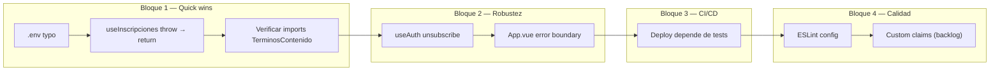

# Plan de Resolución de Problemas — SIGE

> Análisis hecho el 27/10/2026. Tests: 59/59 ✅ · Build: ✅

---

## Estado actual de cada problema documentado

### ✅ Ya resueltos (no requieren acción)

| # | Problema | Evidencia |
|---|----------|-----------|
| 3 | `firestore.rules` — wildcard hardcodeado + auto-confirmación | Marcado ✅ en contexto.md. Deployado el 19/10. |
| F2-1 | Validación semántica del CSV de usuarios | Marcado ✅ en contexto.md. `useImportarUsuarios.js` valida todo-o-nada. |
| 6 | `ResetPassword.vue` — import directo de Firebase + `alert()` | **Ya refactorizado**: usa `useAuth().resetPassword()`, feedback en UI, sin `alert()`. |
| 8 | `Register.vue` — import no usado de `FormCheckbox` | **Ya resuelto parcialmente**: `FormCheckbox` se importa Y se usa (línea 38-44, checkbox de términos). La redirección hardcodeada a `/estudiante` también fue removida (ahora delega en `onAuthStateChanged`). |
| 9 | `BarraApp.vue` — `alert('Función no implementada')` | **Ya resuelto**: la función `solicitarBaja()` ahora usa `console.warn('[TODO]...')` (línea 194), sin `alert()`. |
| 11 | `useLayout.js` — `setLayout('acceso')` a nivel de módulo | **Ya resuelto**: no hay `setLayout()` a nivel de módulo. Solo `currentLayout = ref('acceso')` como valor inicial (correcto) y un comentario explícito: "El layout se configura en el router guard". |
| 19 | CI/CD — workflow de tests y deploy | **Parcialmente resuelto**: el secreto se arregló, el deploy script funciona. **Pendiente**: el deploy de `main` no depende del job de tests (`test-and-validate.yml` y `firebase-hosting-main.yml` son workflows independientes). |
| 21 | Datos personales en repo público | **Resuelto**: CSVs movidos a `data/` (ignorado en `.gitignore`). Solo queda `data/README.md` trackeado. **Pendiente menor**: los archivos siguen en el historial de git. |
| 64 (notas) | `alert()` en `SeleccionarRol.vue` | **Ya resuelto**: comentarios indican que se reemplazó por estado de error en UI. |
| 7 | Duplicado de `TerminosContenido.vue` | Verificado en `src/`: ningún import apunta a `@/components/TerminosContenido.vue`; la copia canónica es `src/components/legal/TerminosContenido.vue`. ✅ Bloque 1 / Paso 3. |
| 17 | `useInscripciones.js` lanza `throw` | Reemplazado por `return { exito: false, error }` en L13, L39 y L47. Tests actualizados en `useInscripciones.spec.js`. ✅ Bloque 1 / Paso 2. |
| 22 | Typo en `.env`: `firebasestore.app` → `firebasestorage.app` | Corregido en `.env` L4. Build ✅. ✅ Bloque 1 / Paso 1. |
| 16 | `useAuth.js` — `onAuthStateChanged` unsubscribe | **Resuelto (Bloque 2/Paso 4)**: `unsubscribeAuth` guardado en variable de módulo; se llama antes de registrar un nuevo listener y en `logoutFirebase`. Tests 59/59 ✅. |
| 14 | `App.vue` — error boundary global | **Resuelto (Bloque 2/Paso 5)**: `onErrorCaptured` agregado en `<script setup>` con logging. Build ✅. |
| 13 | **No hay ESLint configurado** | **Resuelto (Bloque 4/Paso 7)**: `eslint.config.js` creado con flat config v9, script `"lint": "eslint src/"` agregado a `package.json`. Reglas configuradas como `warn` inicialmente. `npm run lint` sale con código 0. Tests 59/59 ✅ · Build ✅. |

### 🔴 Pendientes de resolver

| # | Problema | Archivo(s) | Severidad |
|---|----------|------------|-----------|
| F2-2 | **Re-importar usuarios ya registrados crea doc huérfano** | Decisión de diseño, no acción de código inmediata | 🟡 Backlog |
| F2-3 | **Roles en Firestore rules = lecturas extra facturadas** | **Resuelto (Bloque 4/Paso 8)**: custom claims en `registrarUsuario` + reglas leen `request.auth.token['roles']`. Tests 13/13 ✅. Usuarios existentes necesitan script de migración. | 🟡 Backlog (migración script) |

---

## Plan de trabajo paso a paso

> [!IMPORTANT]
> Cada paso es autónomo: se puede hacer un commit después de cada uno.
> Después de **cada cambio**, correr `npm run test:unit` + `npm run build`.

### Bloque 1 — Correcciones rápidas (bajo riesgo, alto valor) ✅ Completado

#### Paso 1: Corregir typo en `.env` ✅ Completado
- **Archivo**: [`.env`](file:///c:/Users/genar/Documents/DEV/sige/.env) L4
- **Cambio**: `firebasestore.app` → `firebasestorage.app`
- **Riesgo**: Ninguno (hoy no se usa Firebase Storage, pero previene un bug futuro)
- **Test**: Build sigue pasando

#### Paso 2: Unificar convención de error en `useInscripciones.js` ✅ Completado
- **Archivo**: [`useInscripciones.js`](file:///c:/Users/genar/Documents/DEV/sige/src/composables/inscripciones/useInscripciones.js)
- **Cambios**:
  1. L13: Reemplazar `throw new Error('Usuario no autenticado')` por `return { exito: false, error: new Error('Usuario no autenticado') }`
  2. L39: Reemplazar `throw e` por `return { exito: false, error: e }` (el `inscribirAMateria` ya retorna `{ exito: true }` en el happy path pero lanza en el catch)
  3. L47: Igual que L13 para `cargarInscripciones`
- **Riesgo**: Bajo. Los componentes que llaman a estas funciones ya manejan `{ exito, error }` (ver `InscripcionesE.vue`). Revisar que ningún caller use `try/catch` esperando el `throw`.
- **Test**: Actualizar `useInscripciones.spec.js` — los tests que esperan `toThrow` deben esperar `{ exito: false }`.

#### Paso 3: Verificar que no queden imports rotos de `TerminosContenido.vue` ✅ Completado
- **Archivo**: Buscar en todo `src/` imports de `@/components/TerminosContenido.vue` (sin `legal/`)
- **Cambio**: Si hay alguno, actualizar la ruta a `@/components/legal/TerminosContenido.vue`
- **Riesgo**: Ninguno
- **Test**: Build pasa

### Bloque 2 — Mejora de robustez (riesgo medio) ✅ Completado

#### Paso 4: Guardar unsubscribe de `onAuthStateChanged` en `useAuth.js` ✅ Completado
- **Archivo**: [`useAuth.js`](file:///c:/Users/genar/Documents/DEV/sige/src/composables/auth/useAuth.js) L49
- **Cambio**: Almacenar el valor de retorno de `onAuthStateChanged` en una variable de módulo (`let unsubscribeAuth = null`). Antes de registrar un nuevo listener (L43-49), llamar `unsubscribeAuth?.()`. En `logoutFirebase`, llamar `unsubscribeAuth?.()` y setear a `null`.
- **Riesgo**: Bajo. En producción (SPA sin HMR) no cambia el comportamiento. En desarrollo con HMR evita listeners acumulados.
- **Test**: Los tests existentes de `useAuth.spec.js` siguen pasando (el mock de `onAuthStateChanged` ya retorna una función).

#### Paso 5: Agregar error boundary global en `App.vue` ✅ Completado
- **Archivo**: [`App.vue`](file:///c:/Users/genar/Documents/DEV/sige/src/App.vue)
- **Cambio**: En `<script setup>`, agregar:
  ```js
  import { onErrorCaptured } from 'vue'
  onErrorCaptured((err, instance, info) => {
    console.error('[SIGE] Error no capturado:', err, info)
    // No retornar false → deja que el error siga propagándose (por ahora)
    return false
  })
  ```
- **Riesgo**: Ninguno (es solo logging, no cambia comportamiento)
- **Test**: Build pasa

### Bloque 3 — Infra / CI-CD

#### Paso 6: Hacer que el deploy dependa de los tests ✅ Completado
- **Archivo**: [`.github/workflows/firebase-hosting-main.yml`](file:///c:/Users/genar/Documents/DEV/sige/.github/workflows/firebase-hosting-main.yml)
- **Opción B aplicada**: Agregado step `npm run test:unit` directamente en `firebase-hosting-main.yml` **antes** de `npm run build`, como gate local. Si los tests fallan, el workflow se detiene y no se despliega.
- **Riesgo**: Bajo. Solo agrega un gate.
- **Test**: El workflow se prueba con un push a `main`.

### Bloque 4 — Mejoras de calidad (cuando haya tiempo)

#### Paso 7: Configurar ESLint (flat config v9) ✅ Completado
- **Archivos nuevos**: `eslint.config.js`
- **Cambio**: Instalado `eslint`, `@eslint/js`, `eslint-plugin-vue`, `globals`. Creada config flat con reglas recomendadas + regla `no-restricted-imports` para `firebase/firestore` (sin `/lite`). Agregado script `"lint": "eslint src/"` a `package.json`. Todo configurado como `warn` inicialmente para no romper CI.
- **Test**: `npm run lint` sale con código 0 (553 problemas, 7 errors → 0 errors, solo warnings). Tests 59/59 ✅ · Build ✅.

#### Paso 8 (Backlog F2-3): Migrar roles a custom claims ✅ Completado
- **Archivos**: `codebase-functions/index.js` (CF `registrarUsuario`), `firestore.rules`, `tests/integration/firestore-rules.spec.js`
- **Cambio**: En `registrarUsuario`, después de `auth.createUser()`, se agregó `await auth.setCustomUserClaims(nuevoUid, { roles: perfilTemporal.roles || [] })`. En `firestore.rules`, las funciones `esAdmin()` / `esBedel()` / `esCoordinacion()` ahora leen `request.auth.token['roles']` (cero lecturas extra a Firestore). Los tests de integración se actualizaron para incluir `roles` en los claims del token de prueba.
- **Test**: `npm run test:integration` → 13/13 ✅. `npm run test:unit` → 59/59 ✅. `npm run build` → ✅.
- **Nota pendiente**: Los usuarios ya registrados en producción necesitan un script de migración para recibir custom claims (los tokens se refrescan cada hora).

---

## Resumen visual



> [!TIP]
> Los pasos 1 a 5 se pueden completar en una sola sesión. El paso 6 requiere un push a `main` para validar. Los pasos 7 y 8 son mejoras progresivas.
